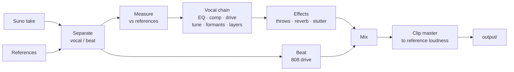

<p align="center">
  
</p>

<h1 align="center">Redline</h1>

<p align="center">
  Takes a rap track made in Suno and moves its sound toward the SoundCloud tracks you pick as references.<br>
  Writes new lyrics in the style of the scene, fitted to your beat.
</p>

<p align="center">
  <b>English</b> · <a href="README.ru.md">Русский</a>
</p>

---

Suno gets the song right and the sound wrong: the vocal sits clean and polite, the 808 is
soft, the master is quiet. The scene it imitates is loud, dirty, tuned hard and clipped. Redline
measures that gap on your own references and closes it, while you listen. Numbers only say how
close the track got to the references, and every change is compared at equal loudness. Whether
it sounds better is for you to decide by ear.

## What it does

| | |
|---|---|
| **Measure** | Splits the track and each reference into vocal and beat, measures loudness, dynamics, spectral tilt, stereo width, the low end, vocal tuning and reverb tails, and writes a report on where the track stands against the references. |
| **Process** | Runs the vocal through a chain built from those measurements: EQ toward the references, compression, saturation, hard tune, formant shift, octave layers, doubles. Then delay throws, reverb and stutter at phrase ends, drive on the 808, and a clip master to the references' loudness. |
| **Studio** | A local page that plays the track through the chain in real time: move a control and you hear it at once. The vocal, beat and master run in the browser on the same Rust code as the render. A/B against the original and a reference at equal loudness, automation lanes, undo, presets. |
| **Record** | Records your vocal over a beat while you hear yourself through the vocal rack with under 10 ms of delay, lines every take up with the beat, and ranks the takes of a song by timing, clipping, noise, dropouts and beat in the mic. |
| **Song** | One page for a whole song, laid out as a signal path: beat → text → recording → takes → mix → result. The page drives the recording engine, ranks takes as they land, runs the auto mix with seeded variants to compare at equal loudness, and writes the result. |
| **Beats** | An agent writes a beat as a score (drum steps with rolls, a gliding 808, chords and melodies, sections, a mix) from a recipe drawn by seed, and a Rust synth plays it: drums and 808 by synthesis, keys, plucks and pads by FM, string models and supersaws, plus a few free CC0 instrument libraries. The beat page edits it bar by bar with the sound changing as you click, measures the render against the references' beats, and takes your marks on bars into the next beat. |
| **Batch** | Runs a saved studio preset over a whole folder of Suno takes in one command. |
| **Lyrics** | Writes a new text from a style profile of the scene, measures your beat for tempo, bars and hardness so the lines fit it, checks every draft for copied lines, and prints a card ready to paste into Suno. You mark lines as cringe or good, and the next text takes those marks into account. |

## How a track goes through



Separation uses a MelBand Roformer model through `audio-separator`; stems and measurements
are cached by content, so the second run on the same files starts at once.

## Quick start

Linux, Python 3.12, [uv](https://docs.astral.sh/uv/), a Rust toolchain (`cargo`) and Node 22.18
or newer. The sound core is Rust: `uv sync` builds it for Python, and its WebAssembly build for
the studio is committed, so emscripten is needed only to change the core. A CUDA GPU speeds up
separation; on a CPU it is slower but works. Recording needs JACK; PipeWire's `pipewire-jack`
is enough.

```sh
git clone https://github.com/paranoica/redline-music.git
cd redline-music
uv sync --extra separation        # add --extra stress for stress-aware rhymes
npm --prefix apps/studio ci && npm --prefix apps/studio run build   # the studio page
```

Put your files in place. These folders are ignored by git:

```
input/track.wav        the take from Suno
input/refs/*.mp3       3-10 reference tracks of the sound you want
```

Then:

```sh
uv run redline measure --track input/track.wav --ref input/refs   # where the track stands
uv run redline studio  --track input/track.wav --ref input/refs   # tune it live
uv run redline run     --track input/track.wav --ref input/refs   # render with the picks
```

`run` writes `output/<time>-<take>/` with `final.wav`, the stems, an `original.wav` brought to
the same loudness, a `compare/` pair at equal loudness and a `report.md`.

## One song, one page

A song ties a beat, a text and a voice together in `private/songs/<name>/song.json`. Start one
and open its page:

```sh
uv run redline song new my-song --beat-seed 7 --text-seed 12 --ref input/refs/*.mp3
uv run redline song studio my-song
```

`--beat FILE` takes a type beat instead of an own one, `--suno FILE` a Suno track instead of
recorded takes; `redline song refs` changes the references later.

The page reads like a patch line across six stations: **Beat → Text → Recording → Takes →
Mix → Result**. The line is lit up to where the song has got, so what is missing shows without
a checklist, and each station says what it needs and how to get it.

- **Beat**: the beat page sits inside it; the render becomes the song's beat.
- **Text**: pick a version, edit it by hand (saved as the next version after the same checks
  the writer's texts pass), or get the command that asks the writer for a new one.
- **Recording**: opens the recording engine and shows its stages, then one button (or `R`)
  for a take. The text stays beside it in large type. Red appears only while a take records.
- **Takes**: each finished take is ranked as it lands; play one over the beat and take it.
- **Mix**: the studio sits inside it. Auto mix finds the settings closest to the references and
  draws three variants by seed, each one setting a grid step away. They are there to be heard:
  the auto result is the closest the search found, so the variants usually measure further.
  Click a pad to hear it, keep one or none.
- **Result**: renders the final track into `output/<song>/`.

Long work (separation, ranking, auto mix, the result) runs as separate processes you can
cancel, and waits while a take records so the audio stays clean. Closing the tab never stops a
take; stopping the server keeps it. The mix and beat surfaces need a screen 1024 px wide; the
rest works on a phone. More in [docs/song.md](docs/song.md).

## The studio

```sh
uv run redline studio --track input/track.wav --ref input/refs
```

It opens a page on `127.0.0.1`. The track plays through the vocal, beat and master racks in
the browser, compiled to WebAssembly from the same Rust core the render uses, so a moved control
is heard at once. The loudest stretch is looped; drag the red brackets to move the loop. What
needs the whole track (the EQ fit toward the references, the master gain) is worked out again
on the server when a setting it depends on changes; the page shows while it runs.

**Exact render** renders the whole track on the server and plays it under **Render**. **Save**
keeps the settings of the last exact render, so what is saved is what was rendered. A rack
effect's automation shows under the waveform as lanes: click to add a point, drag to move,
double-click to remove.

| Key | |
|---|---|
| `Space` | play / pause |
| `L` | loop on / off |
| `B` | original / result |
| `R` | reference |
| `Ctrl+Z`, `Ctrl+Shift+Z` | undo, redo |

Save a preset in the studio, then process every take of a song with it:

```sh
uv run redline run --preset "my preset" --track input/takes/ --ref input/refs
```

A take that fails is reported and the rest still run.

`run`, `voice` and the studio's exact render go through the same vocal, beat and master racks
the studio plays live, so the file is what you heard. `--classic` renders with the old Python
engine instead.

## Your own vocal

Recorded the vocal yourself? Give Redline the vocal and the beat as two files instead of a
Suno take. Nothing of yours is separated: both go into the chain as they are, and only the
references are split.

```sh
uv run redline voice --vocal input/vocal.wav --beat input/beat.wav --ref input/refs
```

The vocal should be dry, recorded over this beat and exported from the same session, so the
two files start together. If they do not, `--offset 0.25` delays the vocal by a quarter of a
second; a negative offset drops the vocal's start.

Without `--settings` or `--preset`, `voice` searches for the settings itself: it renders a few
8-second windows spread over the sung part of the track at several vocal levels, compressor
thresholds and drives, and keeps the ones whose vocal, measured after the master, comes closest
to the references' medians. It prints what it chose, the distance to the references before
and after, and which values ended at the edge of their range, where a better one may lie
beyond. That is closest to the references by measurement; whether it sounds better is yours to
judge. `--no-auto` renders the picks instead.

The result is the same folder `run` writes, named after the vocal; `chain.json` also holds the
search's result. To tune it by ear, open the studio on the pair:

```sh
uv run redline studio --vocal input/vocal.wav --beat input/beat.wav --ref input/refs
```

The first time it starts from the settings the search found; after that, from what is saved.

## Recording takes

`redline record` plays a beat and records the mic, and you hear yourself through the vocal
rack while you sing. It runs on JACK, which on most Linux desktops is PipeWire with
`pipewire-jack`. The engine is a small Rust program, built on first use with
`cargo build --release -p redline-rec --features jack`.

Calibrate once per setup. Hold a headphone cup to the mic (or run a cable from the output to
the input) and run:

```sh
uv run redline record --calibrate
```

It plays a sweep, finds how late it comes back and stores that per ports, rate and buffer
size in `work/record/latency.json`. Every take is shifted by this round trip, so frame 0 of a
take is frame 0 of the beat. Without a calibration the ports' own latency is used and called an
estimate wherever it is shown. A calibration made for other ports, rate or buffer size is
refused, not applied.

Then record:

```sh
uv run redline record --beat input/beat.wav --song my-song --ref input/refs
```

Space starts and stops a take, `r` throws the last one away, `q` quits. The status line shows
the take number, the level, the rate and buffer size the system gave, the monitor's delay and
dropouts. The engine asks for a 64-frame buffer; above 128 it says the 10 ms target is not met.
If the rack is too slow for the budget, effects are switched off from the end of the rack for
monitoring only, and the terminal names them. The takes are dry: the rack is only for your ears.

Takes land in `input/takes/<song>/take-NN.wav`, each with a `take-NN.json` that logs any gap
the engine had to fill. Then rank them:

```sh
uv run redline takes --beat input/beat.wav --dir input/takes/my-song
```

Timing is judged against the other takes, not a grid, so a laid-back flow is not punished.
Clipping, noise between phrases, dropouts and beat bleeding into the mic count against a take.
`--deep --ref input/refs` also measures how close each take gets to the references after the
automatic settings, about 40 s a take. The report and `ranking.json` go to
`work/takes/<song>/`, with the `redline voice` line for the best take. Whether it is the best
performance is still for you to judge.

## Beats

A beat starts as a seed. `redline beat write` draws a recipe from it (genre, tempo, key,
swing, sounds, structure, a few moves such as dropping the 808 before a hook) and hands a
request to the `beatmaker` agent, which answers with a score in JSON. Run the command again and
it checks the score: the format to the step, notes in the key, the 808's range, the bar count.
A score that fails goes back with every problem named by its place, up to four rounds.

```sh
uv run redline beat write --seed 7 --genre trap        # the request for the agent
uv run redline beat write --seed 7                     # checks the answer, saves score-1.json
uv run redline beat render --seed 7                    # work/beats/7/beat.wav and a stem per sound
uv run redline beat measure --seed 7 --ref input/refs  # against the references' beats
uv run redline beat studio --seed 7                    # the page
```

A score is written in steps, sixteen to a bar. A drum row is a string with one character per
step: `x` a hit, `X` an accent, `g` a ghost, `2 3 4 6` a roll of that many hits, `.` a rest.
Optional lanes set velocity, pitch, decay and chance per step. Notes have a step, a length, a
name and a velocity, and two overlapping notes on the 808 glide. Sections say which patterns
play for how many bars, what is muted and which fill takes the last bar. The full format is in
[docs/beats.md](docs/beats.md).

The page shows the whole song as a strip of bars. Click a bar and the grid below shows what
plays in it, every row on one time axis; edits are heard at once, checked as you go and saved
as the next `score-N.json`, never over an old one. Mark a bar good or bad with `G` and `B`:
the mark keeps the bar as it was written, and the next request of that genre quotes it.

The render is the same Rust code the page plays, so the file is what you heard. `measure`
compares it with the beats split out of your references; those are separated stems and the
render is clean, which the report says next to the numbers. As everywhere here, the numbers
say closer or further, not better.

Sounds: drums, the 808, FM keys and bells, plucked strings and supersaws are synthesized and
yours to use. Recorded instruments come only from libraries whose licence is checked at the
source. `redline beat sounds list` shows them with their licence; `redline beat sounds fetch
vsco-harp` downloads one into `work/sounds/`, pinned to a commit and checked file by file. The
ten listed now are CC0. A beat that uses a sound you may not sell says so in its render report.

## Voice lab

The voice lab is a rack: a list of effects that the vocal goes through in your order, after the
built-in effects and before the beat is mixed in. The effects are written in Rust
(`apps/redline-dsp`), so the rack needs that module built; with an empty rack nothing changes
and the module is not needed.

| Family | Effects |
|---|---|
| level and tone | gain, pan, width, eq, filter, exciter |
| dynamics | compressor, gate, deesser, limiter, multiband, duck, transient |
| dirt | saturate, distort, bitcrush, downsample, telephone, radio, lofi, underwater, whisper |
| pitch | pitch, formant, octaver, harmonizer, unison, vibrato, drift, robot, tune |
| synth voice | vocoder, talkbox, ring_mod, freq_shift, comb, resonator |
| time | varispeed, timestretch, tape_stop, tape_start, reverse, freeze, granular, stutter, chop, trance_gate |
| space | room, plate, hall, shimmer, gated_reverb, reverse_reverb, delay, tape_delay, throws, chorus, flanger, phaser, doubler, autopan |

`redline effects` prints every effect with its params, their ranges, defaults and units;
`redline effects --json` prints the same list as JSON. The beat is the rack's side signal, so
`duck`, a compressor with its detector on `side` and the vocoder's beat carrier listen to it.

The rack lives in the settings file, which says `"version": 2`:

```json
{
 "version": 2,
 "vocal_db": -6.0,
 "rack": [
  {"effect": "tune", "params": {"key": "A", "scale": "minor", "speed": 0}},
  {"effect": "delay", "on": false, "params": {"mode": "pingpong", "time": 375}},
  {
   "effect": "gain",
   "params": {"db": 0},
   "automation": [{"param": "db", "points": [[0, -12], [8, 0]]}]
  }
 ]
}
```

`on` defaults to true and a param left out to its default; a choice param takes the choice's
name or its index. A file without `version` is an old one and has no rack. An unknown effect, an
unknown param or a value out of range is refused when the file loads, naming what is wrong.

`automation` moves a param over the track: points of `[seconds, value]` from the start of the
track, in order of time, straight lines between them; before the first point the param holds
the first value and after the last the last one. Two points at the same second make a jump.
Points are in seconds only; naming a section of the lyrics (a hook, a verse) is not supported
yet. A choice param cannot be automated.

`redline run` and `redline voice` take the rack from `--settings` or `--preset` like every other
setting. In the studio the rack is a card of its own: add an effect, move its params, switch it
off, reorder or remove it. Lanes from a saved file are kept but not edited there.

## Lyrics

The lyrics module works from a private base of texts you collect yourself. It is never part
of this repository, and the writer never sees another artist's lines, only numbers and single
words drawn from them.

```sh
uv run redline lyrics index                                      # profiles + copy-check digests
uv run redline lyrics write --seed 53 --beat input/beats/beat.mp3   # a new text for this beat
uv run redline lyrics edit  --seed 53 "make the hook harder"     # the next version
uv run redline lyrics suno  --seed 53                            # the card to paste into Suno
uv run redline lyrics marks                                      # mark lines cringe or good
```

`write` and `edit` hand a request file to a writer agent and exit with code 3 until the draft
is back; run the same command again to check it. A draft goes back with reasons when it
copies eight or more words in a row from any text in the base or breaks the line form. Your
newest marks go into every request: the cringe lines as what to stay away from, the good ones
as the level to hold.

In Suno, upload the beat, choose **Edit vocals**, and paste the card's style, exclusions and
lyrics.

## Privacy

The repository is public. Audio, texts, references, measurements and results live only in
ignored folders:

| Folder | What lives there |
|---|---|
| `input/` | your takes, beats and references |
| `private/` | the lyrics base, generated texts, beat scores and marks, the spec |
| `work/` | caches, studio settings and presets, renders, downloaded sounds |
| `output/` | results |

Every folder the tool writes into also ignores itself. Tests use only audio generated by code.

## Commands

| Command | What it does |
|---|---|
| `redline measure` | measure a track against references, write a report |
| `redline vocal` | blind listening round on the vocal chain |
| `redline master` | blind round on the master, timbre, voice or 808 |
| `redline song new` | start a song: a beat, a text, a voice, references |
| `redline song studio` | the song page |
| `redline song refs` | set a song's references |
| `redline song list`, `show` | the songs, one song's file |
| `redline studio` | the live page |
| `redline run` | render one take or a folder of takes with the picks, a settings file or a preset |
| `redline voice` | render your own recorded vocal over a beat, with settings found by measurement |
| `redline record` | record takes over a beat, hearing yourself through the vocal rack; `--calibrate` measures the round trip |
| `redline takes` | rank recorded takes of a song: timing against the other takes, clipping, noise, dropouts, beat in the mic |
| `redline beat write` | a beat score by seed, through the beatmaker agent |
| `redline beat render` | render a score to a WAV and a stem per sound |
| `redline beat measure` | measure the render against the references' beats |
| `redline beat studio` | the beat page |
| `redline beat marks` | mark a bar good or bad, or list the marks |
| `redline beat sounds` | list or fetch the recorded instrument libraries |
| `redline effects` | the rack's effects with their params and ranges (`--json` for the raw list) |
| `redline lyrics index` | build style profiles and copy-check digests from the base |
| `redline lyrics write` | write a new text by seed, optionally for a beat |
| `redline lyrics edit` | change a saved text by an instruction |
| `redline lyrics suno` | print the Suno card of a saved text |
| `redline lyrics marks` | the page to mark lines cringe or good |
| `redline lyrics check` | exit 1 if a text copies the base |
| `redline lyrics stats` | syllables and rhyme letters per line |

`redline <command> --help` lists every option.

## Layout

```
apps/
  redline/          the Python package
    core/           audio I/O, DSP, loudness, spectrum, pitch
    measure/        separation, measurements, comparison, report
    vocal/          the vocal chain, timbre, effects, blind rounds
    master/         clip master, the final run
    engine/         settings, the staged render with its cache, the racks the studio plays
    record/         the recording session: engine driver, calibration, takes
    takes/          measuring and ranking takes
    beat/           recipes, the beatmaker's rounds, checks, render, marks, sounds, the beat page's server
    studio/         the studio's server
    song/           the song file, the recording engine's owner, jobs, variants, the song page's server
    lyrics/         text parsing, style profiles, the writer, Suno cards, marks
    web/            what the local pages share: token, host check, headers
    cli/            the command line
  redline-dsp/      the Rust sound core: effects, rack, master, the beat synth; built for Python
                    and the browser; rec/ is the recording engine
  studio/           the song, studio and beat pages, TypeScript
  lyrics-web/       the marks page
tests/redline/      tests, on synthetic audio and invented texts
docs/               the sound, beats and lyrics guides
```

More detail: [docs/song.md](docs/song.md), [docs/sound.md](docs/sound.md), [docs/beats.md](docs/beats.md),
[docs/lyrics.md](docs/lyrics.md),
[docs/lyrics-profile.md](docs/lyrics-profile.md).

## Development

```sh
uv run pytest tests/redline -q        # tests
uvx ruff check . && uvx black --check .
uv run pyright apps/redline
npm --prefix apps/studio test         # the studio page
npm --prefix apps/studio run typecheck
```

`apps/redline-dsp/wasm/build.sh` rebuilds the browser build of the core (needs emscripten); see
[apps/studio/README.md](apps/studio/README.md).

`plugins/` and `bench/` hold [bedrock](https://github.com/paranoica/bedrock), the development
workflow this project is built with. They are not part of the program.

## Licence

MIT, see [LICENSE](LICENSE). Voice effects use [Praat](https://www.fon.hum.uva.nl/praat/)
through `praat-parselmouth` (GPL-3.0), and separation uses `audio-separator` (MIT) with
models under their own licences.
