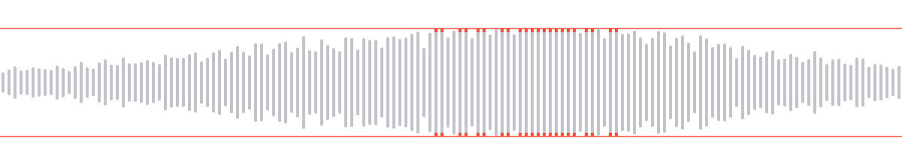
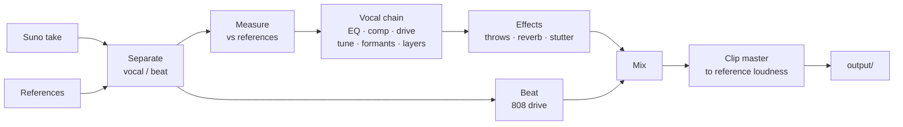

<p align="center">
  
</p>

<h1 align="center">Redline</h1>

<p align="center">
  Takes a rap track made in Suno and moves its sound toward the SoundCloud tracks you pick as references.<br>
  Writes new lyrics in the style of the scene, fitted to your beat.
</p>

<p align="center">
  <b>English</b> · <a href="README.ru.md">Русский</a>
</p>

---

Suno gets the song right and the sound wrong: the vocal sits clean and polite, the 808 is
soft, the master is quiet. The scene it imitates is loud, dirty, tuned hard and clipped. Redline
measures that gap on your own references and closes it, while you listen. Numbers only say how
close the track got to the references, and every change is compared at equal loudness. Whether
it sounds better is for you to decide by ear.

## What it does

| | |
|---|---|
| **Measure** | Splits the track and each reference into vocal and beat, measures loudness, dynamics, spectral tilt, stereo width, the low end, vocal tuning and reverb tails, and writes a report on where the track stands against the references. |
| **Process** | Runs the vocal through a chain built from those measurements: EQ toward the references, compression, saturation, hard tune, formant shift, octave layers, doubles. Then delay throws, reverb and stutter at phrase ends, drive on the 808, and a clip master to the references' loudness. |
| **Studio** | A local page that plays the track and re-renders a loop as you move a setting. A/B against the original and a reference at equal loudness, undo, presets. |
| **Batch** | Runs a saved studio preset over a whole folder of Suno takes in one command. |
| **Lyrics** | Writes a new text from a style profile of the scene, measures your beat for tempo, bars and hardness so the lines fit it, checks every draft for copied lines, and prints a card ready to paste into Suno. You mark lines as cringe or good, and the next text takes those marks into account. |

## How a track goes through



Separation uses a MelBand Roformer model through `audio-separator`; stems and measurements
are cached by content, so the second run on the same files starts at once.

## Quick start

Linux, Python 3.12, [uv](https://docs.astral.sh/uv/) and a Rust toolchain (`cargo`): the master's
inner loops are Rust, built by `uv sync`. A CUDA GPU speeds up separation; on a CPU it is
slower but works.

```sh
git clone https://github.com/paranoica/redline-music.git
cd redline-music
uv sync --extra separation        # add --extra stress for stress-aware rhymes
```

Put your files in place. These folders are ignored by git:

```
input/track.wav        the take from Suno
input/refs/*.mp3       3-10 reference tracks of the sound you want
```

Then:

```sh
uv run redline measure --track input/track.wav --ref input/refs   # where the track stands
uv run redline studio  --track input/track.wav --ref input/refs   # tune it live
uv run redline run     --track input/track.wav --ref input/refs   # render with the picks
```

`run` writes `output/<time>-<take>/` with `final.wav`, the stems, an `original.wav` brought to
the same loudness, a `compare/` pair at equal loudness and a `report.md`.

## The studio

```sh
uv run redline studio --track input/track.wav --ref input/refs
```

It opens a page on `127.0.0.1`. The loudest stretch of the track is looped; drag the red
brackets to move the loop. A change re-renders only the loop, in about two seconds; the
whole track renders on a button, in about twenty seconds for a three-minute song.

| Key | |
|---|---|
| `Space` | play / pause |
| `L` | loop on / off |
| `B` | original / result |
| `R` | reference |
| `Ctrl+Z`, `Ctrl+Shift+Z` | undo, redo |

Save a preset in the studio, then process every take of a song with it:

```sh
uv run redline run --preset "my preset" --track input/takes/ --ref input/refs
```

A take that fails is reported and the rest still run.

`run`, `voice` and the studio's exact render go through the same vocal, beat and master racks
the studio plays live, so the file is what you heard. `--classic` renders with the old Python
engine instead.

## Your own vocal

Recorded the vocal yourself? Give Redline the vocal and the beat as two files instead of a
Suno take. Nothing of yours is separated: both go into the chain as they are, and only the
references are split.

```sh
uv run redline voice --vocal input/vocal.wav --beat input/beat.wav --ref input/refs
```

The vocal should be dry, recorded over this beat and exported from the same session, so the
two files start together. If they do not, `--offset 0.25` delays the vocal by a quarter of a
second; a negative offset drops the vocal's start.

Without `--settings` or `--preset`, `voice` searches for the settings itself: it renders a few
8-second windows spread over the sung part of the track at several vocal levels, compressor
thresholds and drives, and keeps the ones whose vocal, measured after the master, comes closest
to the references' medians. It prints what it chose, the distance to the references before
and after, and which values ended at the edge of their range, where a better one may lie
beyond. That is closest to the references by measurement; whether it sounds better is yours to
judge. `--no-auto` renders the picks instead.

The result is the same folder `run` writes, named after the vocal; `chain.json` also holds the
search's result. To tune it by ear, open the studio on the pair:

```sh
uv run redline studio --vocal input/vocal.wav --beat input/beat.wav --ref input/refs
```

The first time it starts from the settings the search found; after that, from what is saved.

## Voice lab

The voice lab is a rack: a list of effects that the vocal goes through in your order, after the
built-in effects and before the beat is mixed in. The effects are written in Rust
(`apps/redline-dsp`), so the rack needs that module built; with an empty rack nothing changes
and the module is not needed.

| Family | Effects |
|---|---|
| level and tone | gain, pan, width, eq, filter, exciter |
| dynamics | compressor, gate, deesser, limiter, multiband, duck, transient |
| dirt | saturate, distort, bitcrush, downsample, telephone, radio, lofi, underwater, whisper |
| pitch | pitch, formant, octaver, harmonizer, unison, vibrato, drift, robot, tune |
| synth voice | vocoder, talkbox, ring_mod, freq_shift, comb, resonator |
| time | varispeed, timestretch, tape_stop, tape_start, reverse, freeze, granular, stutter, chop, trance_gate |
| space | room, plate, hall, shimmer, gated_reverb, reverse_reverb, delay, tape_delay, throws, chorus, flanger, phaser, doubler, autopan |

`redline effects` prints every effect with its params, their ranges, defaults and units;
`redline effects --json` prints the same list as JSON. The beat is the rack's side signal, so
`duck`, a compressor with its detector on `side` and the vocoder's beat carrier listen to it.

The rack lives in the settings file, which says `"version": 2`:

```json
{
 "version": 2,
 "vocal_db": -6.0,
 "rack": [
  {"effect": "tune", "params": {"key": "A", "scale": "minor", "speed": 0}},
  {"effect": "delay", "on": false, "params": {"mode": "pingpong", "time": 375}},
  {
   "effect": "gain",
   "params": {"db": 0},
   "automation": [{"param": "db", "points": [[0, -12], [8, 0]]}]
  }
 ]
}
```

`on` defaults to true and a param left out to its default; a choice param takes the choice's
name or its index. A file without `version` is an old one and has no rack. An unknown effect, an
unknown param or a value out of range is refused when the file loads, naming what is wrong.

`automation` moves a param over the track: points of `[seconds, value]` from the start of the
track, in order of time, straight lines between them; before the first point the param holds
the first value and after the last the last one. Two points at the same second make a jump.
Points are in seconds only; naming a section of the lyrics (a hook, a verse) is not supported
yet. A choice param cannot be automated.

`redline run` and `redline voice` take the rack from `--settings` or `--preset` like every other
setting. In the studio the rack is a card of its own: add an effect, move its params, switch it
off, reorder or remove it. Lanes from a saved file are kept but not edited there.

## Lyrics

The lyrics module works from a private base of texts you collect yourself. It is never part
of this repository, and the writer never sees another artist's lines, only numbers and single
words drawn from them.

```sh
uv run redline lyrics index                                      # profiles + copy-check digests
uv run redline lyrics write --seed 53 --beat input/beats/beat.mp3   # a new text for this beat
uv run redline lyrics edit  --seed 53 "make the hook harder"     # the next version
uv run redline lyrics suno  --seed 53                            # the card to paste into Suno
uv run redline lyrics marks                                      # mark lines cringe or good
```

`write` and `edit` hand a request file to a writer agent and exit with code 3 until the draft
is back; run the same command again to check it. A draft goes back with reasons when it
copies eight or more words in a row from any text in the base or breaks the line form. Your
newest marks go into every request: the cringe lines as what to stay away from, the good ones
as the level to hold.

In Suno, upload the beat, choose **Edit vocals**, and paste the card's style, exclusions and
lyrics.

## Privacy

The repository is public. Audio, texts, references, measurements and results live only in
ignored folders:

| Folder | What lives there |
|---|---|
| `input/` | your takes, beats and references |
| `private/` | the lyrics base, generated texts, the spec |
| `work/` | caches, studio settings and presets |
| `output/` | results |

Every folder the tool writes into also ignores itself. Tests use only audio generated by code.

## Commands

| Command | What it does |
|---|---|
| `redline measure` | measure a track against references, write a report |
| `redline vocal` | blind listening round on the vocal chain |
| `redline master` | blind round on the master, timbre, voice or 808 |
| `redline studio` | the live page |
| `redline run` | render one take or a folder of takes with the picks, a settings file or a preset |
| `redline voice` | render your own recorded vocal over a beat, with settings found by measurement |
| `redline effects` | the rack's effects with their params and ranges (`--json` for the raw list) |
| `redline lyrics index` | build style profiles and copy-check digests from the base |
| `redline lyrics write` | write a new text by seed, optionally for a beat |
| `redline lyrics edit` | change a saved text by an instruction |
| `redline lyrics suno` | print the Suno card of a saved text |
| `redline lyrics marks` | the page to mark lines cringe or good |
| `redline lyrics check` | exit 1 if a text copies the base |
| `redline lyrics stats` | syllables and rhyme letters per line |

`redline <command> --help` lists every option.

## Layout

```
apps/
  redline/          the Python package
    core/           audio I/O, DSP, loudness, spectrum, pitch
    measure/        separation, measurements, comparison, report
    vocal/          the vocal chain, timbre, effects, blind rounds
    master/         clip master, the final run
    engine/         settings and the staged render with its cache
    studio/         the studio's server
    lyrics/         text parsing, style profiles, the writer, Suno cards, marks
    web/            what the local pages share: token, host check, headers
    cli/            the command line
  redline-dsp/      the Rust inner loops: oversampled clip, resampling, filters, loudness
  studio/           the studio page, TypeScript
  lyrics-web/       the marks page
tests/redline/      tests, on synthetic audio and invented texts
docs/               the sound and lyrics guides
```

More detail: [docs/sound.md](docs/sound.md), [docs/lyrics.md](docs/lyrics.md),
[docs/lyrics-profile.md](docs/lyrics-profile.md).

## Development

```sh
uv run pytest tests/redline -q        # tests
uvx ruff check . && uvx black --check .
uv run pyright apps/redline
```

`plugins/` and `bench/` hold [bedrock](https://github.com/paranoica/bedrock), the development
workflow this project is built with. They are not part of the program.

## Licence

MIT, see [LICENSE](LICENSE). Voice effects use [Praat](https://www.fon.hum.uva.nl/praat/)
through `praat-parselmouth` (GPL-3.0), and separation uses `audio-separator` (MIT) with
models under their own licences.
