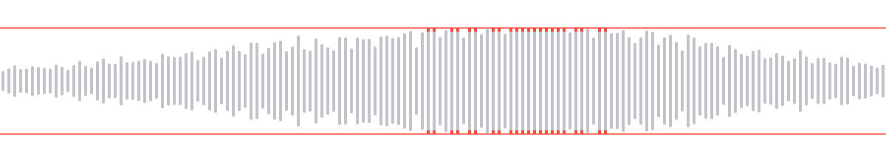
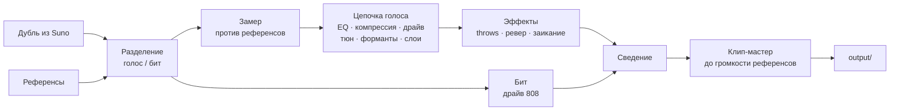

<p align="center">
  
</p>

<h1 align="center">Redline</h1>

<p align="center">
  Берёт рэп-трек, сделанный в Suno, и приближает его звук к трекам с SoundCloud, которые ты выбрал как референсы.<br>
  Пишет новые тексты в стиле сцены, под твой бит.
</p>

<p align="center">
  <a href="README.md">English</a> · <b>Русский</b>
</p>

---

Песню Suno собирает правильно, а звук нет: голос чистый и вежливый, 808 мягкий, мастер тихий.
А сцена, под которую он косит, громкая, грязная, с жёстким тюном и клиппингом. Redline меряет
эту разницу на твоих же референсах и сокращает её, пока ты слушаешь. Цифры показывают только,
насколько трек приблизился к референсам, и любое сравнение идёт на равной громкости. Лучше ли
звучит, решаешь ты, на слух.

## Что умеет

| | |
|---|---|
| **Замер** | Делит трек и каждый референс на голос и бит, меряет громкость, динамику, наклон спектра, ширину стерео, низ, строй голоса и хвосты ревера, пишет отчёт: где трек относительно референсов. |
| **Обработка** | Прогоняет голос через цепочку, собранную по замерам: эквалайзер к референсам, компрессия, сатурация, хард-тюн, сдвиг формант, октавные слои, даблы. Дальше delay throws, ревер и заикание на концах фраз, перегруз 808 и клип-мастер до громкости референсов. |
| **Студия** | Локальная страница: трек играет через цепочку вживую, сдвинул ручку — сразу слышно. Голос, бит и мастер считаются в браузере тем же кодом на Rust, что и рендер. A/B с оригиналом и референсом на равной громкости, автоматизация, отмена, пресеты. |
| **Запись** | Пишет твой голос поверх бита, пока ты слышишь себя через вокальный рэк с задержкой меньше 10 мс, выравнивает каждый дубль по биту и ранжирует дубли песни по таймингу, клипу, шуму, выпадениям и биту в микрофоне. |
| **Песня** | Одна страница на всю песню, разложенная как сигнальная цепь: бит → текст → запись → дубли → сведение → итог. Страница управляет движком записи, ранжирует дубли по мере записи, запускает автосведение с вариантами по сиду для сравнения на равной громкости и собирает итог. |
| **Биты** | Агент пишет бит партитурой (шаги ударных с роллами, 808 с глайдами, аккорды и мелодии, секции, микс) по рецепту, вытянутому из сида, а синтезатор на Rust его играет: ударные и 808 синтезом, клавиши, щипки и пэды через FM, модель струны и суперсо, плюс несколько свободных библиотек инструментов под CC0. Страница бита правит его по тактам, звук меняется сразу по клику, рендер меряется против битов референсов, а твои отметки на тактах уходят в следующий бит. |
| **Флип** | Разбирает тайп-бит на стемы, читает его сетку и ноты 808 и даёт заменить 808 на наш по тем же нотам, убрать хэты или прописать новые, переставить и повторить такты под текст, поставить остановку ленты, реверс и статтер на выбранные такты. |
| **Пачкой** | Прогоняет сохранённый в студии пресет по целой папке дублей из Suno одной командой. |
| **Тексты** | Пишет новый текст по профилю стиля сцены, меряет твой бит (темп, такты, жёсткость), чтобы строки легли на него, проверяет каждый черновик на копирование и выдаёт карточку, которую остаётся вставить в Suno. Строки можно отмечать как кринж или норм, следующий текст это учтёт. |

## Как идёт трек



Разделение делает модель MelBand Roformer через `audio-separator`. Стемы и замеры кешируются
по содержимому файлов, поэтому второй запуск на тех же файлах стартует сразу.

## Быстрый старт

Linux, Python 3.12, [uv](https://docs.astral.sh/uv/), Rust (`cargo`) и Node 22.18 или новее. Звуковое
ядро на Rust: для Python его собирает `uv sync`, а сборка в WebAssembly для студии лежит в репозитории,
так что emscripten нужен только чтобы менять ядро. Видеокарта с CUDA ускоряет разделение; на
процессоре медленнее, но работает. Для записи нужен JACK; хватит `pipewire-jack` из PipeWire.

```sh
git clone https://github.com/paranoica/redline-music.git
cd redline-music
uv sync --extra separation        # --extra stress — рифмы с учётом ударений
npm --prefix apps/studio ci && npm --prefix apps/studio run build   # страница студии
```

Разложи файлы. Эти папки git не видит:

```
input/track.wav        дубль из Suno
input/refs/*.mp3       3–10 референсов с нужным звуком
```

И дальше:

```sh
uv run redline measure --track input/track.wav --ref input/refs   # где трек сейчас
uv run redline studio  --track input/track.wav --ref input/refs   # крутить вживую
uv run redline run     --track input/track.wav --ref input/refs   # отрендерить
```

`run` пишет папку `output/<время>-<дубль>/`: `final.wav`, стемы, `original.wav` на той же
громкости, пару для сравнения в `compare/` и `report.md`.

## Одна песня — одна страница

```sh
uv run redline app
```

открывает в браузере **Мои песни**: каждая песня карточкой и кнопка **Новая песня** (название,
тайп-бит из `input/beats` или свой бит по сиду, готовый текст или без него; референсы по
умолчанию — всё из `input/refs`). Песня открывается на одном экране, устроенном как DAW:

- **Транспорт** сверху: play/pause (пробел), стоп, запись (R), повтор куска (L), часы в
  секундах и тактах, подсказка, что делать дальше, и **Экспорт**.
- **Дорожки** на линейке тактов: текст, где строки стоят над тактами, на которых их читать;
  голос (выбранный дубль) и под ним все дубли; бит по частям, а у своего бита ещё ноты 808 и
  барабаны. Звёздочка выбирает дубль, маленький ▶ играет один дубль поверх бита.
- **Редактор** снизу, для выбранной дорожки: пианоролл 808 и сетка барабанов своего бита
  (правка слышна сразу, выбранная часть крутится по кругу); пять крутилок голоса (громкость,
  чистота, эхо, реверб, тюн) и **Авто**, которое ставит их ближе всего к референсам; текст, его
  версии и где стоят строки.

Запись идёт с первого такта: бит играет нативный движок, и дубль ложится ровно на него.
Разделение, автосведение и экспорт идут в фоне и ждут, пока пишется дубль.
`redline song studio <имя>` сразу открывает одну песню; `redline song new` по-прежнему работает
из терминала. Подробнее — [docs/song.md](docs/song.md).

## Флип тайп-бита

Если бит песни — файл, его дорожка на экране песни — это флип. Один клик делит бит на стемы и
читает его сетку тактов и ноты 808. Дальше прямо на таймлайне:

- блоки тактов: перетащить, скопировать с Ctrl, разрезать, удалить или взять расстановку под текст
  песни (такт на строку, припев на самом повторяющемся куске);
- 808: оригинал, наш по тем же нотам (с подстройкой под строй исходника) или выключен; ноты блока
  правятся в пиано-ролле;
- хэты: оригинал, убраны или прописаны заново по блокам; сетка барабанов добавляет наши бочку,
  снейр, клэп, хэты и перкуссию поверх исходника;
- эффекты на блок: реверс, остановка и разгон ленты, статтер, гранулярка.

Правки собираются сами, когда нажимаешь play, запись или экспорт: каждая сборка — новая версия,
доведённая к громкости исходника под потолком −1 dBFS, и она становится битом песни (первая правка
один раз спросит, если под старый бит уже записаны дубли). Правка бита
не меняет его лицензию. Подробнее: [docs/flip.md](docs/flip.md).

## Студия

```sh
uv run redline studio --track input/track.wav --ref input/refs
```

Открывает страницу на `127.0.0.1`. Трек играет через рэки голоса, бита и мастера прямо в
браузере, в WebAssembly из того же ядра на Rust, что и рендер, поэтому сдвинутую ручку слышно
сразу. Самый громкий кусок трека играет петлёй; красные скобки двигаются мышкой. То, что требует
всего трека (подгонка эквалайзера под референсы, усиление мастера), сервер пересчитывает, когда
меняется настройка, от которой это зависит; страница показывает, что идёт пересчёт.

**Точный рендер** считает весь трек на сервере, его можно слушать на вкладке **Рендер**.
**Сохранить** сохраняет настройки последнего точного рендера, так что сохраняется ровно то, что
отрендерено. Автоматизация эффекта рэка видна под волной дорожками: клик ставит точку,
перетаскивание двигает, двойной клик удаляет.

| Клавиша | |
|---|---|
| `Пробел` | играть / пауза |
| `L` | петля вкл / выкл |
| `B` | оригинал / результат |
| `R` | референс |
| `Ctrl+Z`, `Ctrl+Shift+Z` | отменить, вернуть |

Сохрани пресет в студии и прогони им все дубли песни:

```sh
uv run redline run --preset "мой пресет" --track input/takes/ --ref input/refs
```

Если какой-то дубль не обработался, программа скажет, какой именно, а остальные доделает.

`run`, `voice` и точный рендер в студии идут через те же рэки вокала, бита и мастера, что
студия играет вживую, поэтому в файле то же, что ты слышал. `--classic` рендерит старым
движком на Python.

## Свой голос

Записал голос сам? Дай Redline голос и бит двумя файлами вместо дубля из Suno. Твоё ничего не
разделяется: оба файла идут в цепочку как есть, на голос и бит делятся только референсы.

```sh
uv run redline voice --vocal input/vocal.wav --beat input/beat.wav --ref input/refs
```

Голос нужен сухой, записанный под этот бит и выгруженный из той же сессии, чтобы оба файла
начинались вместе. Если не совпадают, `--offset 0.25` сдвинет голос на четверть секунды позже;
отрицательный сдвиг срежет начало голоса.

Без `--settings` и `--preset` команда `voice` подбирает настройки сама: рендерит несколько
8-секундных окон, разнесённых по той части трека, где звучит голос, на нескольких уровнях
голоса, порогах компрессора и драйвах и оставляет те, при которых голос, замеренный после
мастера, ближе всего к медианам референсов. Печатает, что выбрала, расстояние до референсов до
и после и какие значения упёрлись в край своего диапазона: лучшее может лежать за ним. Это
ближе всего к референсам по замерам; лучше ли звучит, решать тебе.
`--no-auto` рендерит со значениями по умолчанию.

Результат — та же папка, что пишет `run`, названная по голосу; в `chain.json` есть и итог
подбора. Чтобы докрутить на слух, открой студию на этой паре:

```sh
uv run redline studio --vocal input/vocal.wav --beat input/beat.wav --ref input/refs
```

В первый раз она стартует с подобранных настроек, дальше — с сохранённых.

## Запись дублей

`redline record` играет бит и пишет микрофон, а ты, пока поёшь, слышишь себя через вокальный
рэк. Работает через JACK; на большинстве Linux-десктопов это PipeWire с `pipewire-jack`. Движок
записи — небольшая программа на Rust, она собирается при первом запуске командой
`cargo build --release -p redline-rec --features jack`.

Один раз на сетап сделай калибровку. Приложи чашку наушника к микрофону (или соедини выход со
входом кабелем) и запусти:

```sh
uv run redline record --calibrate
```

Команда играет свип, находит, насколько поздно он возвращается, и сохраняет это для портов,
частоты и размера буфера в `work/record/latency.json`. Каждый дубль сдвигается на эту задержку,
так что кадр 0 дубля — это кадр 0 бита. Без калибровки берётся задержка, которую сообщают сами
порты, и везде, где она показана, она названа оценкой. Калибровка, снятая для других портов,
частоты или буфера, отклоняется, а не применяется.

Потом записывай:

```sh
uv run redline record --beat input/beat.wav --song my-song --ref input/refs
```

Пробел начинает и останавливает дубль, `r` выкидывает последний, `q` выходит. В строке
состояния — номер дубля, уровень, частота и буфер, которые дала система, задержка прослушки и
выпадения. Движок просит буфер 64 кадра; если дали больше 128, он прямо говорит, что 10 мс не
выходит. Если рэк не влезает в бюджет задержки, эффекты с конца рэка выключаются только для
прослушки, и терминал их называет. Дубли пишутся сухими: рэк только для твоих ушей.

Дубли ложатся в `input/takes/<песня>/take-NN.wav`, рядом с каждым `take-NN.json` с журналом
дыр, которые движку пришлось заполнить. Потом ранжируй их:

```sh
uv run redline takes --beat input/beat.wav --dir input/takes/my-song
```

Тайминг сравнивается с другими дублями, а не с сеткой, так что расслабленная подача не
штрафуется. Против дубля идут клип, шум между фразами, выпадения и бит, пролезший в микрофон.
`--deep --ref input/refs` ещё меряет, насколько близко каждый дубль подходит к референсам после
автонастроек, около 40 с на дубль. Отчёт и `ranking.json` ложатся в `work/takes/<песня>/`,
вместе со строкой `redline voice` для лучшего дубля. Лучшее ли это исполнение, всё равно решать
тебе.

## Биты

Бит начинается с сида. `redline beat write` вытягивает из него рецепт (жанр, темп,
тональность, свинг, звуки с одним ведущим голосом, структуру, пару приёмов вроде паузы 808
перед хуком, стиль 808 и один-два хода «против учебника», например бочку вне сетки или смену
бита; жанров четырнадцать) и отдаёт запрос агенту `beatmaker`, который отвечает партитурой в JSON. Запусти команду ещё раз — она
проверит партитуру: формат до шага, ноты в тональности, диапазон 808, число тактов. Партитура с
ошибками уходит обратно, каждая ошибка названа по месту, до четырёх раундов.

```sh
uv run redline beat write --seed 7 --genre trap        # запрос агенту
uv run redline beat write --seed 7                     # проверить ответ, сохранить score-1.json
uv run redline beat render --seed 7                    # work/beats/7/beat.wav и стем на каждый звук
uv run redline beat measure --seed 7 --ref input/refs  # против битов референсов
uv run redline beat studio --seed 7                    # страница
```

Партитура пишется шагами, по шестнадцать на такт. Строка ударного — по символу на шаг: `x`
удар, `X` акцент, `g` призрак, `2 3 4 6` ролл из стольких ударов, `.` пауза. Необязательные
дорожки задают громкость, высоту, затухание и шанс на каждом шаге. У ноты есть шаг, длина, имя
и громкость; две ноты 808 внахлёст — глайд. Секции говорят, какие паттерны играют сколько
тактов, что заглушено и какая сбивка занимает последний такт. Полный формат — в
[docs/beats.md](docs/beats.md).

Страница показывает всю песню лентой тактов. Кликни такт — сетка под ней покажет, что в нём
играет, все строки на одной оси времени; правки слышны сразу, проверяются на ходу и
сохраняются следующим `score-N.json`, никогда поверх старого. Отметь такт как хороший или
плохой клавишами `G` и `B`: отметка запоминает такт таким, каким он был написан, и следующий
запрос того же жанра его процитирует.

Рендер — тот же код на Rust, что играет страница, поэтому файл — это то, что ты слышал.
`measure` сравнивает его с битами, отделёнными от твоих референсов; у референсов это стемы после
сепаратора, а рендер чистый, и отчёт говорит об этом рядом с числами. Как и везде здесь, числа
говорят «ближе» или «дальше», а не «лучше».

Звуки: ударные, 808, FM-клавиши и колокола, щипковые струны и суперсо синтезированы, их можно
использовать как угодно. Записанные инструменты берутся только из библиотек, чья лицензия
проверена у источника. `redline beat sounds list` покажет их с лицензиями; `redline beat
sounds fetch vsco-harp` скачает одну в `work/sounds/`, с закреплённого коммита и с проверкой
каждого файла. Все десять, что есть сейчас, под CC0. Если бит использует звук, который нельзя
продавать, отчёт о рендере об этом скажет.

## Голосовая лаборатория

Голосовая лаборатория — это рэк: список эффектов, через которые голос идёт в твоём порядке,
после встроенных эффектов и до того, как к нему подмешивается бит. Эффекты написаны на Rust
(`apps/redline-dsp`), поэтому для рэка этот модуль должен быть собран; с пустым рэком ничего не
меняется и модуль не нужен.

| Семейство | Эффекты |
|---|---|
| громкость и тон | gain, pan, width, eq, filter, exciter |
| динамика | compressor, gate, deesser, limiter, multiband, duck, transient |
| грязь | saturate, distort, bitcrush, downsample, telephone, radio, lofi, underwater, whisper |
| высота | pitch, formant, octaver, harmonizer, unison, vibrato, drift, robot, tune |
| синтетический голос | vocoder, talkbox, ring_mod, freq_shift, comb, resonator |
| время | varispeed, timestretch, tape_stop, tape_start, reverse, freeze, granular, stutter, chop, trance_gate |
| пространство | room, plate, hall, shimmer, gated_reverb, reverse_reverb, delay, tape_delay, throws, chorus, flanger, phaser, doubler, autopan |

`redline effects` печатает все эффекты с параметрами, их диапазонами, значениями по умолчанию
и единицами; `redline effects --json` — тот же список в JSON. Бит — боковой сигнал рэка, его
слышат `duck`, компрессор с детектором на `side` и вокодер с битом в качестве несущей.

Рэк лежит в файле настроек, в котором стоит `"version": 2`:

```json
{
 "version": 2,
 "vocal_db": -6.0,
 "rack": [
  {"effect": "tune", "params": {"key": "A", "scale": "minor", "speed": 0}},
  {"effect": "delay", "on": false, "params": {"mode": "pingpong", "time": 375}},
  {
   "effect": "gain",
   "params": {"db": 0},
   "automation": [{"param": "db", "points": [[0, -12], [8, 0]]}]
  }
 ]
}
```

`on` по умолчанию true, пропущенный параметр берёт значение по умолчанию; параметр с выбором
принимает имя варианта или его номер. Файл без `version` — старый, рэка в нём нет. Неизвестный
эффект, неизвестный параметр или значение вне диапазона отклоняются при загрузке файла, с
указанием, что не так.

`automation` двигает параметр по треку: точки `[секунды, значение]` от начала трека, по
порядку времени, между ними прямые; до первой точки параметр держит первое значение, после
последней — последнее. Две точки на одной секунде дают скачок. Точки задаются только в
секундах; привязка к части текста (хук, куплет) пока не поддерживается. Параметр с выбором
автоматизировать нельзя.

`redline run` и `redline voice` берут рэк из `--settings` или `--preset`, как и остальные
настройки. В студии у рэка своя карточка: добавить эффект, крутить его параметры, выключить,
переставить или убрать. Линии автоматизации из сохранённого файла сохраняются, но там не
редактируются.

## Тексты

Модуль текстов работает с приватной базой текстов, которую ты собираешь сам. В репозиторий она
не попадает никогда, а писатель не видит ни одной чужой строки, только цифры и отдельные
слова из профиля.

```sh
uv run redline lyrics index                                      # профили и отпечатки для проверки
uv run redline lyrics write --seed 53 --beat input/beats/beat.mp3   # новый текст под этот бит
uv run redline lyrics edit  --seed 53 "сделай хук жёстче"        # следующая версия
uv run redline lyrics suno  --seed 53                            # карточка для Suno
uv run redline lyrics marks                                      # отметить строки: кринж или норм
```

`write` и `edit` отдают файл запроса агенту-писателю и выходят с кодом 3, пока черновик не
вернулся; та же команда ещё раз проверяет его. Черновик возвращается на доработку с причинами,
если в нём восемь и больше слов подряд из любого текста базы или он ломает форму строк. Твои
последние отметки идут в каждый запрос: кринж как то, от чего держаться подальше, норм как
планка.

В Suno загрузи бит, выбери **Edit vocals** и вставь из карточки стиль, исключения и текст.

## Приватность

Репозиторий публичный. Аудио, тексты, референсы, замеры и результаты живут только в папках,
которые git игнорирует:

| Папка | Что там |
|---|---|
| `input/` | твои дубли, биты и референсы |
| `private/` | база текстов, сгенерированные тексты, партитуры битов и отметки, ТЗ |
| `work/` | кеши, настройки и пресеты студии, рендеры, скачанные звуки |
| `output/` | результаты |

Каждая папка, в которую пишет программа, ещё и сама себя прячет от git. Тесты работают только
на звуке, сгенерированном кодом.

## Команды

| Команда | Что делает |
|---|---|
| `redline measure` | замерить трек против референсов, написать отчёт |
| `redline vocal` | слепой раунд на цепочке голоса |
| `redline master` | слепой раунд на мастере, тембре, голосе или 808 |
| `redline song new` | завести песню: бит, текст, голос, референсы |
| `redline song studio` | страница песни |
| `redline song refs` | задать референсы песни |
| `redline song list`, `show` | песни, файл одной песни |
| `redline flip analyse`, `render`, `propose`, `clean` | флип тайп-бита из командной строки |
| `redline studio` | живая страница |
| `redline run` | отрендерить дубль или папку дублей: по умолчанию, из файла настроек или по пресету |
| `redline voice` | отрендерить свой записанный голос на бите, с настройками, подобранными по замерам |
| `redline record` | записать дубли поверх бита, слыша себя через вокальный рэк; `--calibrate` меряет задержку туда и обратно |
| `redline takes` | ранжировать записанные дубли песни: тайминг против других дублей, клип, шум, выпадения, бит в микрофоне |
| `redline beat write` | партитура бита по сиду, через агента beatmaker |
| `redline beat render` | отрендерить партитуру в WAV и по стему на звук |
| `redline beat measure` | замерить рендер против битов референсов |
| `redline beat studio` | страница бита |
| `redline beat marks` | отметить такт как хороший или плохой, или показать отметки |
| `redline beat sounds` | список библиотек записанных инструментов или скачать одну |
| `redline effects` | эффекты рэка с параметрами и диапазонами (`--json` — сырой список) |
| `redline lyrics index` | собрать профили стиля и отпечатки из базы |
| `redline lyrics write` | написать новый текст по сиду, можно под бит |
| `redline lyrics edit` | изменить сохранённый текст по указанию |
| `redline lyrics suno` | карточка Suno для сохранённого текста |
| `redline lyrics marks` | страница разметки строк |
| `redline lyrics check` | код 1, если текст копирует базу |
| `redline lyrics stats` | слоги и буквы рифм по строкам |

`redline <команда> --help` покажет все опции.

## Устройство

```
apps/
  redline/          Python-пакет
    core/           ввод-вывод аудио, DSP, громкость, спектр, высота тона
    measure/        разделение, замеры, сравнение, отчёт
    vocal/          цепочка голоса, тембр, эффекты, слепые раунды
    master/         клип-мастер, финальный рендер
    engine/         настройки, рендер по стадиям с кешем, рэки, которые играет студия
    record/         сессия записи: управление движком, калибровка, дубли
    takes/          замер и ранжирование дублей
    beat/           рецепты, раунды битмейкера, проверки, рендер, отметки, звуки, сервер страницы бита
    studio/         сервер студии
    song/           файл песни, владелец движка записи, задачи, варианты, сервер страницы песни
    flip/           стемы тайп-бита, сетка, ноты 808, наши 808 и хэты, такты и эффекты
    lyrics/         разбор текстов, профили стиля, писатель, карточки Suno, разметка
    web/            общее у локальных страниц: токен, проверка хоста, заголовки
    cli/            командная строка
  redline-dsp/      звуковое ядро на Rust: эффекты, рэк, мастер, синтезатор битов; сборки для
                    Python и браузера; в rec/ движок записи
  studio/           страницы песни, студии и бита, TypeScript
  lyrics-web/       страница разметки
tests/redline/      тесты на синтетическом звуке и выдуманных текстах
docs/               руководства по звуку, битам и текстам
```

Подробнее (на английском): [docs/song.md](docs/song.md), [docs/flip.md](docs/flip.md), [docs/sound.md](docs/sound.md), [docs/beats.md](docs/beats.md),
[docs/lyrics.md](docs/lyrics.md),
[docs/lyrics-profile.md](docs/lyrics-profile.md).

## Разработка

```sh
uv run pytest tests/redline -q        # тесты
uvx ruff check . && uvx black --check .
uv run pyright apps/redline
npm --prefix apps/studio test         # страница студии
npm --prefix apps/studio run typecheck
```

`apps/redline-dsp/wasm/build.sh` пересобирает ядро для браузера (нужен emscripten); подробнее в
[apps/studio/README.md](apps/studio/README.md).

В `plugins/` и `bench/` лежит [bedrock](https://github.com/paranoica/bedrock), рабочий процесс,
на котором сделан проект. К самой программе они не относятся.

## Лицензия

MIT, см. [LICENSE](LICENSE). Эффекты голоса используют [Praat](https://www.fon.hum.uva.nl/praat/)
через `praat-parselmouth` (GPL-3.0), разделение — `audio-separator` (MIT) с моделями под их
собственными лицензиями.
