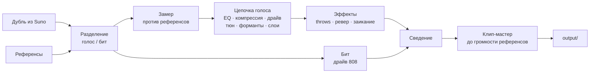

<p align="center">
  
</p>

<h1 align="center">Redline</h1>

<p align="center">
  Берёт рэп-трек, сделанный в Suno, и приближает его звук к трекам с SoundCloud, которые ты выбрал как референсы.<br>
  Пишет новые тексты в стиле сцены, под твой бит.
</p>

<p align="center">
  <a href="README.md">English</a> · <b>Русский</b>
</p>

---

Песню Suno собирает правильно, а звук нет: голос чистый и вежливый, 808 мягкий, мастер тихий.
А сцена, под которую он косит, громкая, грязная, с жёстким тюном и клиппингом. Redline меряет
эту разницу на твоих же референсах и сокращает её, пока ты слушаешь. Цифры показывают только,
насколько трек приблизился к референсам, и любое сравнение идёт на равной громкости. Лучше ли
звучит, решаешь ты, на слух.

## Что умеет

| | |
|---|---|
| **Замер** | Делит трек и каждый референс на голос и бит, меряет громкость, динамику, наклон спектра, ширину стерео, низ, строй голоса и хвосты ревера, пишет отчёт: где трек относительно референсов. |
| **Обработка** | Прогоняет голос через цепочку, собранную по замерам: эквалайзер к референсам, компрессия, сатурация, хард-тюн, сдвиг формант, октавные слои, даблы. Дальше delay throws, ревер и заикание на концах фраз, перегруз 808 и клип-мастер до громкости референсов. |
| **Студия** | Локальная страница: играет трек и перерендеривает петлю, пока двигаешь настройку. A/B с оригиналом и референсом на равной громкости, отмена, пресеты. |
| **Пачкой** | Прогоняет сохранённый в студии пресет по целой папке дублей из Suno одной командой. |
| **Тексты** | Пишет новый текст по профилю стиля сцены, меряет твой бит (темп, такты, жёсткость), чтобы строки легли на него, проверяет каждый черновик на копирование и выдаёт карточку, которую остаётся вставить в Suno. Строки можно отмечать как кринж или норм, следующий текст это учтёт. |

## Как идёт трек



Разделение делает модель MelBand Roformer через `audio-separator`. Стемы и замеры кешируются
по содержимому файлов, поэтому второй запуск на тех же файлах стартует сразу.

## Быстрый старт

Linux, Python 3.12, [uv](https://docs.astral.sh/uv/) и Rust (`cargo`): внутренние циклы мастера на
Rust, их собирает `uv sync`. Видеокарта с CUDA ускоряет разделение; на процессоре медленнее,
но работает.

```sh
git clone https://github.com/paranoica/redline-music.git
cd redline-music
uv sync --extra separation        # --extra stress — рифмы с учётом ударений
```

Разложи файлы. Эти папки git не видит:

```
input/track.wav        дубль из Suno
input/refs/*.mp3       3–10 референсов с нужным звуком
```

И дальше:

```sh
uv run redline measure --track input/track.wav --ref input/refs   # где трек сейчас
uv run redline studio  --track input/track.wav --ref input/refs   # крутить вживую
uv run redline run     --track input/track.wav --ref input/refs   # отрендерить
```

`run` пишет папку `output/<время>-<дубль>/`: `final.wav`, стемы, `original.wav` на той же
громкости, пару для сравнения в `compare/` и `report.md`.

## Студия

```sh
uv run redline studio --track input/track.wav --ref input/refs
```

Открывает страницу на `127.0.0.1`. Самый громкий кусок трека играет петлёй; красные скобки
двигаются мышкой. Изменение перерендеривает только петлю, это около двух секунд. Весь трек
рендерится по кнопке, около двадцати секунд на трёхминутную песню.

| Клавиша | |
|---|---|
| `Пробел` | играть / пауза |
| `L` | петля вкл / выкл |
| `B` | оригинал / результат |
| `R` | референс |
| `Ctrl+Z`, `Ctrl+Shift+Z` | отменить, вернуть |

Сохрани пресет в студии и прогони им все дубли песни:

```sh
uv run redline run --preset "мой пресет" --track input/takes/ --ref input/refs
```

Если какой-то дубль не обработался, программа скажет, какой именно, а остальные доделает.

## Свой голос

Записал голос сам? Дай Redline голос и бит двумя файлами вместо дубля из Suno. Твоё ничего не
разделяется: оба файла идут в цепочку как есть, на голос и бит делятся только референсы.

```sh
uv run redline voice --vocal input/vocal.wav --beat input/beat.wav --ref input/refs
```

Голос нужен сухой, записанный под этот бит и выгруженный из той же сессии, чтобы оба файла
начинались вместе. Если не совпадают, `--offset 0.25` сдвинет голос на четверть секунды позже;
отрицательный сдвиг срежет начало голоса.

Без `--settings` и `--preset` команда `voice` подбирает настройки сама: рендерит несколько
8-секундных окон, разнесённых по той части трека, где звучит голос, на нескольких уровнях
голоса, порогах компрессора и драйвах и оставляет те, при которых голос, замеренный после
мастера, ближе всего к медианам референсов. Печатает, что выбрала, расстояние до референсов до
и после и какие значения упёрлись в край своего диапазона: лучшее может лежать за ним. Это
ближе всего к референсам по замерам; лучше ли звучит, решать тебе.
`--no-auto` рендерит со значениями по умолчанию.

Результат — та же папка, что пишет `run`, названная по голосу; в `chain.json` есть и итог
подбора. Чтобы докрутить на слух, открой студию на этой паре:

```sh
uv run redline studio --vocal input/vocal.wav --beat input/beat.wav --ref input/refs
```

В первый раз она стартует с подобранных настроек, дальше — с сохранённых.

## Голосовая лаборатория

Голосовая лаборатория — это рэк: список эффектов, через которые голос идёт в твоём порядке,
после встроенных эффектов и до того, как к нему подмешивается бит. Эффекты написаны на Rust
(`apps/redline-dsp`), поэтому для рэка этот модуль должен быть собран; с пустым рэком ничего не
меняется и модуль не нужен.

| Семейство | Эффекты |
|---|---|
| громкость и тон | gain, pan, width, eq, filter, exciter |
| динамика | compressor, gate, deesser, limiter, multiband, duck, transient |
| грязь | saturate, distort, bitcrush, downsample, telephone, radio, lofi, underwater, whisper |
| высота | pitch, formant, octaver, harmonizer, unison, vibrato, drift, robot, tune |
| синтетический голос | vocoder, talkbox, ring_mod, freq_shift, comb, resonator |
| время | varispeed, timestretch, tape_stop, tape_start, reverse, freeze, granular, stutter, chop, trance_gate |
| пространство | room, plate, hall, shimmer, gated_reverb, reverse_reverb, delay, tape_delay, throws, chorus, flanger, phaser, doubler, autopan |

`redline effects` печатает все эффекты с параметрами, их диапазонами, значениями по умолчанию
и единицами; `redline effects --json` — тот же список в JSON. Бит — боковой сигнал рэка, его
слышат `duck`, компрессор с детектором на `side` и вокодер с битом в качестве несущей.

Рэк лежит в файле настроек, в котором стоит `"version": 2`:

```json
{
 "version": 2,
 "vocal_db": -6.0,
 "rack": [
  {"effect": "tune", "params": {"key": "A", "scale": "minor", "speed": 0}},
  {"effect": "delay", "on": false, "params": {"mode": "pingpong", "time": 375}},
  {
   "effect": "gain",
   "params": {"db": 0},
   "automation": [{"param": "db", "points": [[0, -12], [8, 0]]}]
  }
 ]
}
```

`on` по умолчанию true, пропущенный параметр берёт значение по умолчанию; параметр с выбором
принимает имя варианта или его номер. Файл без `version` — старый, рэка в нём нет. Неизвестный
эффект, неизвестный параметр или значение вне диапазона отклоняются при загрузке файла, с
указанием, что не так.

`automation` двигает параметр по треку: точки `[секунды, значение]` от начала трека, по
порядку времени, между ними прямые; до первой точки параметр держит первое значение, после
последней — последнее. Две точки на одной секунде дают скачок. Точки задаются только в
секундах; привязка к части текста (хук, куплет) пока не поддерживается. Параметр с выбором
автоматизировать нельзя.

`redline run` и `redline voice` берут рэк из `--settings` или `--preset`, как и остальные
настройки. В студии у рэка своя карточка: добавить эффект, крутить его параметры, выключить,
переставить или убрать. Линии автоматизации из сохранённого файла сохраняются, но там не
редактируются.

## Тексты

Модуль текстов работает с приватной базой текстов, которую ты собираешь сам. В репозиторий она
не попадает никогда, а писатель не видит ни одной чужой строки, только цифры и отдельные
слова из профиля.

```sh
uv run redline lyrics index                                      # профили и отпечатки для проверки
uv run redline lyrics write --seed 53 --beat input/beats/beat.mp3   # новый текст под этот бит
uv run redline lyrics edit  --seed 53 "сделай хук жёстче"        # следующая версия
uv run redline lyrics suno  --seed 53                            # карточка для Suno
uv run redline lyrics marks                                      # отметить строки: кринж или норм
```

`write` и `edit` отдают файл запроса агенту-писателю и выходят с кодом 3, пока черновик не
вернулся; та же команда ещё раз проверяет его. Черновик возвращается на доработку с причинами,
если в нём восемь и больше слов подряд из любого текста базы или он ломает форму строк. Твои
последние отметки идут в каждый запрос: кринж как то, от чего держаться подальше, норм как
планка.

В Suno загрузи бит, выбери **Edit vocals** и вставь из карточки стиль, исключения и текст.

## Приватность

Репозиторий публичный. Аудио, тексты, референсы, замеры и результаты живут только в папках,
которые git игнорирует:

| Папка | Что там |
|---|---|
| `input/` | твои дубли, биты и референсы |
| `private/` | база текстов, сгенерированные тексты, ТЗ |
| `work/` | кеши, настройки и пресеты студии |
| `output/` | результаты |

Каждая папка, в которую пишет программа, ещё и сама себя прячет от git. Тесты работают только
на звуке, сгенерированном кодом.

## Команды

| Команда | Что делает |
|---|---|
| `redline measure` | замерить трек против референсов, написать отчёт |
| `redline vocal` | слепой раунд на цепочке голоса |
| `redline master` | слепой раунд на мастере, тембре, голосе или 808 |
| `redline studio` | живая страница |
| `redline run` | отрендерить дубль или папку дублей: по умолчанию, из файла настроек или по пресету |
| `redline voice` | отрендерить свой записанный голос на бите, с настройками, подобранными по замерам |
| `redline effects` | эффекты рэка с параметрами и диапазонами (`--json` — сырой список) |
| `redline lyrics index` | собрать профили стиля и отпечатки из базы |
| `redline lyrics write` | написать новый текст по сиду, можно под бит |
| `redline lyrics edit` | изменить сохранённый текст по указанию |
| `redline lyrics suno` | карточка Suno для сохранённого текста |
| `redline lyrics marks` | страница разметки строк |
| `redline lyrics check` | код 1, если текст копирует базу |
| `redline lyrics stats` | слоги и буквы рифм по строкам |

`redline <команда> --help` покажет все опции.

## Устройство

```
apps/
  redline/          Python-пакет
    core/           ввод-вывод аудио, DSP, громкость, спектр, высота тона
    measure/        разделение, замеры, сравнение, отчёт
    vocal/          цепочка голоса, тембр, эффекты, слепые раунды
    master/         клип-мастер, финальный рендер
    engine/         настройки и рендер по стадиям с кешем
    studio/         сервер студии
    lyrics/         разбор текстов, профили стиля, писатель, карточки Suno, разметка
    web/            общее у локальных страниц: токен, проверка хоста, заголовки
    cli/            командная строка
  redline-dsp/      внутренние циклы на Rust: клиппер, передискретизация, фильтры, громкость
  studio/           страница студии, TypeScript
  lyrics-web/       страница разметки
tests/redline/      тесты на синтетическом звуке и выдуманных текстах
docs/               руководства по звуку и текстам
```

Подробнее (на английском): [docs/sound.md](docs/sound.md), [docs/lyrics.md](docs/lyrics.md),
[docs/lyrics-profile.md](docs/lyrics-profile.md).

## Разработка

```sh
uv run pytest tests/redline -q        # тесты
uvx ruff check . && uvx black --check .
uv run pyright apps/redline
```

В `plugins/` и `bench/` лежит [bedrock](https://github.com/paranoica/bedrock), рабочий процесс,
на котором сделан проект. К самой программе они не относятся.

## Лицензия

MIT, см. [LICENSE](LICENSE). Эффекты голоса используют [Praat](https://www.fon.hum.uva.nl/praat/)
через `praat-parselmouth` (GPL-3.0), разделение — `audio-separator` (MIT) с моделями под их
собственными лицензиями.
